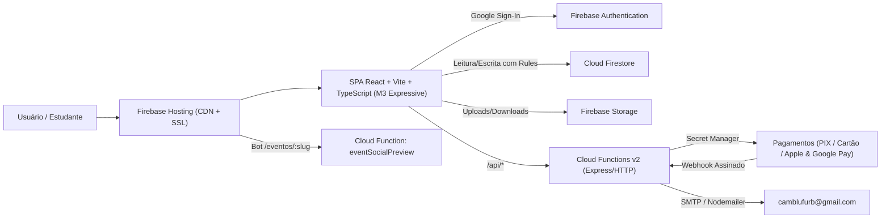

# CAMBLU — Portal Oficial (Medicina FURB)

Portal oficial do **Centro Acadêmico de Medicina de Blumenau (CAMBLU)**, fundado em 1990 para representar os acadêmicos do curso de Medicina da Universidade Regional de Blumenau (FURB).

Construído com **Material Design 3 / Material You Expressive**, tipografia **Roboto Flex**, arquitetura **100% Firebase** (Hosting, Auth Google, Cloud Firestore, Cloud Storage e Cloud Functions v2) e pagamentos digitais integrados.

---

## Sumário

- [Funcionalidades](#funcionalidades)
- [Arquitetura e Stack](#arquitetura-e-stack)
- [Rotas da Plataforma](#rotas-da-plataforma)
- [Desenvolvimento Local](#desenvolvimento-local)
- [Scripts Disponíveis](#scripts-disponíveis)
- [Documentação Técnica](#documentação-técnica)
- [Segurança e Privacidade](#segurança-e-privacidade)
- [Licença](#licença)

---

## Funcionalidades

- **Autenticação Google & Perfil Acadêmico:** login via conta Google com cadastro de dados estudantis (Nome, CPF validado, e-mail, WhatsApp, vínculo FURB/turma ou Externo, e tamanho de camiseta para calouros).
- **Eventos, Ingressos, QR Codes & Certificados:**
  - Páginas individuais com meta tags dinâmicas (*OpenGraph*) para compartilhamento.
  - Múltiplos lotes com `N` QR Codes por ingresso (data/hora e carga horária de certificado individuais) e suporte a eventos virtuais com link reservado aos inscritos.
  - Transferência de ingressos entre contas cadastradas via **CPF**.
  - Validação por leitor de QR Code no `/back` e exportação automática de **certificados em PDF e PNG** sobre template personalizado do Canva.
- **Lojinha Oficial:** catálogo com páginas individuais por produto (`/lojinha/:slug`), galeria multi-imagens, estoque por tamanho, aplicação de descontos do Clube CAMBLU, sacola compartilhada com checkout online, lançamentos manuais e checklist de entrega.
- **Clube CAMBLU:** planos **Comum**, **Raro**, **Épico** e **Lendário** (com efeito *shimmer*), cartão digital do membro reativo ao giroscópio e benefícios em parceiros.
- **Transparência Financeira:** gráficos mensais, distribuição por categorias, mapa de calor anual (*heatmap*), listagem auditável (com saldo restrito à gestão no `/back`), atas de reunião e exportação de lâminas mensais em **1080×1350 px** no `/back`.
- **Calendário, Editais & Ouvidoria:** agenda integrada (`camblufurb@gmail.com`) com exportação `.ics`, repositório de editais com PDF + formulários e envio direto de demandas / CAMBLU Mulher.
- **Vida Estudantil & Pesquisa:** história do CAMBLU e espaços no Edifício Cristina, guia completo da MEDFURB, páginas dedicadas das **Instituições Estudantis** (`CAMBLU`, `DCE FURB`, `AAARIH`, `IFMSA Brazil FURB`), catálogo das **35 Ligas Acadêmicas**, **SECIMED** / **Anais (ISSN 3086-612X)**, **Gestões** e **Manual do Calouro**.

---

## Arquitetura e Stack



- **Frontend:** Vite + React 19 + TypeScript + React Router 7
- **Design System:** Material Design 3 / Material You Expressive (`Roboto Flex` + `Material Symbols Rounded`), tema claro exclusivo em Português (`pt-BR`) e suporte a `prefers-reduced-motion`
- **Backend & Infra:** Firebase Hosting, Firebase Authentication (Google), Cloud Firestore (Standard), Firebase Storage, Cloud Functions v2 (Node.js/TypeScript)
- **Documentos & QR:** `pdf-lib`, `qrcode`, `html5-qrcode`

---

## Rotas da Plataforma

| Rota | Descrição | Acesso |
| :--- | :--- | :--- |
| `/` | Visão geral resumida com direcionamento para todas as áreas | Público |
| `/sobre` & `/espacos` | História do CAMBLU e Espaços no Edifício Cristina | Público |
| `/medfurb` | Sobre o curso, SAEME, diretoria, auxílios, estágios e TCC | Público |
| `/medfurb/instituicoes` | Instituições estudantis (`CAMBLU`, `DCE FURB`, `AAARIH`, `IFMSA`) | Público |
| `/eventos` & `/eventos/:slug` | Catálogo e página do evento (com OpenGraph dinâmico) | Público |
| `/meus-ingressos` | QR Codes dos ingressos e transferência por CPF | Autenticado |
| `/certificados` & `/certificados/validar/:codigo` | Emissão (PDF/PNG) e validação pública | Autenticado / Público |
| `/lojinha` & `/lojinha/:slug` | Catálogo, páginas de produto e sacola | Público / Autenticado |
| `/clube` & `/clube/cartao` | Assinaturas do Clube CAMBLU e cartão digital | Público / Autenticado |
| `/transparencia` | Gráficos, heatmap, movimentações e atas | Público |
| `/calendario` | Calendário integrado (CAMBLU, ligas e editais) | Público |
| `/editais` | Editais em PDF e links de inscrição | Público |
| `/demandas` & `/camblu-mulher` | Envio de demandas por assunto e acolhimento CAMBLU Mulher | Público |
| `/gestoes` | Histórico de gestões com molduras M3 | Público |
| `/ligas` | Catálogo das 35 ligas acadêmicas com logos oficiais | Público |
| `/secimed` & `/secimed/anais-secimed` | Informações da SECIMED e repositório de Anais | Público |
| `/manual-do-calouro` | Manual interativo do calouro MEDFURB | Público |
| `/perfil` | Cadastro e edição de perfil acadêmico | Autenticado |
| `/back` | Painel administrativo da gestão | Restrito à diretoria |

---

## Desenvolvimento Local

```bash
npm install
cp .env.example .env.local
npm run dev
```

---

## Scripts Disponíveis

| Comando | Ação |
| :--- | :--- |
| `npm run dev` | Servidor de desenvolvimento Vite em `http://localhost:5173` |
| `npm run typecheck` | Verificação de tipos TypeScript (`tsc --noEmit`) |
| `npm run test` | Execução da suíte de testes unitários (`vitest`) |
| `npm run build` | Compilação de produção (`tsc -b && vite build`) |
| `npm run preview` | Pré-visualização local do bundle gerado em `dist/` |

---

## Documentação Técnica

- **API Pública do Clube CAMBLU (`GET /api/clube/status`):** [docs/CLUBE_API.md](docs/CLUBE_API.md)
- **Arquitetura de Dados & Cloud Functions:** [docs/ARCHITECTURE.md](docs/ARCHITECTURE.md)
- **Referência de Infraestrutura Firebase:** [docs/FIREBASE_SETUP.md](docs/FIREBASE_SETUP.md)

---

## Segurança e Privacidade

Consulte [SECURITY.md](SECURITY.md) para detalhes sobre guarda de segredos, regras de segurança do Firestore/Storage, proteção contra escalação de privilégios e conformidade LGPD.

---

## Licença

Distribuído sob a licença **MIT**. Veja [LICENSE](LICENSE) para mais informações.  
Copyright © 2026 Centro Acadêmico de Medicina da FURB (`camblufurb@gmail.com`).
