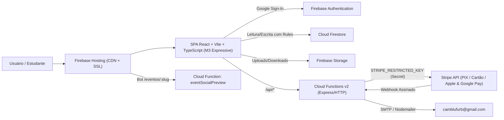

# CAMBLU — Portal Oficial (Medicina FURB)

Portal oficial do **Centro Acadêmico de Medicina de Blumenau (CAMBLU)**, fundado em 1990 para representar os acadêmicos do curso de Medicina da Universidade Regional de Blumenau (FURB).

Construído em **Material Design 3 / Material You Expressive** com tipografia **Roboto Flex**, arquitetura **100% Firebase** (Hosting, Auth Google, Cloud Firestore, Cloud Storage e Cloud Functions v2) e pagamentos via **Stripe** (PIX, Cartão, Google Pay e Apple Pay — com todas as taxas absorvidas pelo CAMBLU).

---

## Sumário

- [Funcionalidades](#funcionalidades)
- [Arquitetura e Stack](#arquitetura-e-stack)
- [Rotas da Plataforma](#rotas-da-plataforma)
- [Clube CAMBLU e API Pública](#clube-camblu-e-api-pública)
- [Configuração Local](#configuração-local)
- [Configuração do Firebase e Stripe](#configuração-do-firebase-e-stripe)
- [Scripts Disponíveis](#scripts-disponíveis)
- [Segurança e Privacidade](#segurança-e-privacidade)
- [Licença](#licença)

---

## Funcionalidades

- **Autenticação Google & Perfil Acadêmico:** login exclusivo via Google com cadastro completo (Nome, CPF validado, e-mail, celular WhatsApp, vínculo FURB com turma numérica ou Externo, e tamanho de camiseta para calouros).
- **Eventos, Ingressos, QR Codes & Certificados:**
  - Páginas individuais com **Social Preview dinâmico (OpenGraph)** para compartilhamento.
  - Lotes múltiplos com N QR Codes por ingresso (cada QR code possui data/hora e carga horária de certificado) ou modo virtual com link liberado próximo ao evento.
  - Transferência segura de ingressos entre contas cadastradas via **CPF**.
  - Validação por câmera no painel `/back` e geração automática de **certificados em PDF e PNG** sobre template PNG exportado do Canva.
- **Lojinha:** catálogo com múltiplas fotos, controle de estoque por tamanho, desconto automático do Clube, checkout Stripe (PIX, Cartão, Google/Apple Pay), lançamento de vendas externas/doações e checklist de entrega com link `wa.me/TELEFONE`.
- **Clube CAMBLU:** planos **Comum**, **Raro**, **Épico** e **Lendário** (com efeito *shimmer*), cartão digital do membro com *shimmer* reativo ao giroscópio do celular e API aberta de consulta por CPF/e-mail.
- **Transparência Financeira:** gráficos mensais, distribuição por categorias, mapa de calor anual (*heatmap*), listagem auditável (mantendo o saldo atual restrito ao painel `/back`), links para atas de reunião no Google Drive e exportador mensal de **4 imagens (1080×1350 px)** para Instagram no `/back`.
- **Calendário Acadêmico, Editais & Demandas:** agenda oficial do CAMBLU (`camblufurb@gmail.com`), repositório de editais com PDF + Google Forms e formulário de demandas/CAMBLU Mulher com envio direto de e-mail por tópico.
- **Institucional, MEDFURB, SECIMED, Ligas, Gestões & Manual do Calouro:**
  - Conteúdo completo sobre o CAMBLU, espaços físicos no Edifício Cristina (com carrossel M3), curso de Medicina da FURB e Acreditação SAEME.
  - **SECIMED** e **Anais SECIMED** em `/secimed/anais-secimed` (ISSN 3086-612X, revisão por pares, CC BY-NC 4.0).
  - Catálogo das **35 Ligas Acadêmicas** e **Histórico de Gestões** com molduras M3 de formas variáveis animadas e cropper 1:1 no `/back`.
  - **Manual do Calouro** interativo baseado no guia oficial MEDFURB 2026.

---

## Arquitetura e Stack



- **Frontend:** Vite 6 + React 19 + TypeScript + React Router 7
- **Design System:** Material Design 3 / Material You Expressive (`Roboto Flex` + `Material Symbols Rounded`), tema claro exclusivo em Português Brasileiro (`pt-BR`) e respeito a `prefers-reduced-motion`
- **Backend & Infra:** Firebase Hosting, Firebase Authentication (Google), Cloud Firestore (Standard), Firebase Storage, Cloud Functions v2 (Node.js/TypeScript)
- **Pagamentos:** Stripe Checkout & Payment Request (Google/Apple Pay, Cartão, PIX)
- **Documentos & QR:** `pdf-lib`, `qrcode`, `html5-qrcode`

---

## Rotas da Plataforma

| Rota | Descrição | Acesso |
| :--- | :--- | :--- |
| `/` | Página inicial (CAMBLU, instituições FURB, destaques) | Público |
| `/sobre` & `/espacos` | História do CAMBLU e Espaços no Edifício Cristina | Público |
| `/medfurb` | Sobre o curso, SAEME, diretoria, auxílios, estágios e TCC | Público |
| `/eventos` & `/eventos/:slug` | Catálogo e página do evento (com OG preview dinâmico) | Público |
| `/meus-ingressos` | QR Codes dos ingressos e transferência por CPF | Autenticado |
| `/certificados` & `/certificados/validar/:codigo` | Emissão (PDF/PNG) e validação pública | Autenticado / Público |
| `/lojinha` | Produtos, tamanhos e checkout Stripe | Público / Autenticado |
| `/clube` & `/clube/cartao` | Assinaturas do Clube CAMBLU e cartão digital com shimmer | Público / Autenticado |
| `/transparencia` | Gráficos, heatmap, movimentações e atas | Público |
| `/calendario` | Calendário integrado (CAMBLU, ligas e editais) | Público |
| `/editais` | Editais em PDF e links de inscrição | Público |
| `/demandas` & `/camblu-mulher` | Envio de demandas por assunto e acolhimento CAMBLU Mulher | Público |
| `/gestoes` | Histórico de gestões com molduras M3 | Público |
| `/ligas` | Catálogo das 35 ligas acadêmicas | Público |
| `/secimed` & `/secimed/anais-secimed` | Informações da SECIMED e repositório de Anais | Público |
| `/manual-do-calouro` | Manual interativo do calouro MEDFURB | Público |
| `/perfil` | Cadastro e edição de perfil acadêmico | Autenticado |
| `/back` | Painel administrativo completo | Apenas `camblufurb@gmail.com` |

---

## Clube CAMBLU e API Pública

Endpoint aberto para integração com parceiros (ex.: Spaiq / Gorit PRO), retornando apenas o status não sensível do plano:

```http
GET /api/clube/status?cpf=00000000000
GET /api/clube/status?email=aluno@exemplo.com
```

Resposta (`200 OK`):

```json
{
  "active": true,
  "tier": "epico",
  "validUntil": "2027-03-01T00:00:00.000Z"
}
```

Valores possíveis de `tier`: `"none"`, `"comum"`, `"raro"`, `"epico"`, `"lendario"`.

---

## Configuração Local

```bash
# 1. Instalar dependências do frontend
npm install

# 2. Copiar variáveis públicas de ambiente
cp .env.example .env.local
# Preencha VITE_FIREBASE_API_KEY, VITE_FIREBASE_APP_ID e VITE_STRIPE_PUBLISHABLE_KEY

# 3. Rodar em desenvolvimento
npm run dev
```

> **Modo Demonstração Local:** caso as variáveis `VITE_FIREBASE_API_KEY` / `VITE_FIREBASE_APP_ID` ainda não estejam preenchidas, a aplicação inicializa automaticamente com dados institucionais reais e persistência local de demonstração para permitir validação visual e funcional completa em `localhost`.

---

## Configuração do Firebase e Stripe

Consulte os guias detalhados em:
- [docs/FIREBASE_SETUP.md](docs/FIREBASE_SETUP.md) — passo a passo para Authentication, Firestore, Storage, Blaze, Secret Manager e domínio `camblu.org`.
- [docs/ARCHITECTURE.md](docs/ARCHITECTURE.md) — modelagem de coleções no Firestore, fluxos de pagamento Stripe e geração de certificados.

---

## Scripts Disponíveis

| Comando | Ação |
| :--- | :--- |
| `npm run dev` | Servidor de desenvolvimento Vite em `http://localhost:5173` |
| `npm run typecheck` | Verificação de tipos TypeScript (`tsc --noEmit`) |
| `npm run test` | Execução da suíte de testes unitários (`vitest`) |
| `npm run build` | Compilação de produção (`tsc -b && vite build`) |
| `npm run preview` | Pré-visualização local do bundle gerado em `dist/` |

---

## Segurança e Privacidade

Consulte [SECURITY.md](SECURITY.md) para detalhes sobre guarda de segredos, regras de segurança do Firestore/Storage, proteção contra escalação de privilégios e conformidade LGPD.

---

## Licença

Distribuído sob a licença **MIT**. Veja [LICENSE](LICENSE) para mais informações.  
Copyright © 2026 Centro Acadêmico de Medicina da FURB (`camblufurb@gmail.com`).
